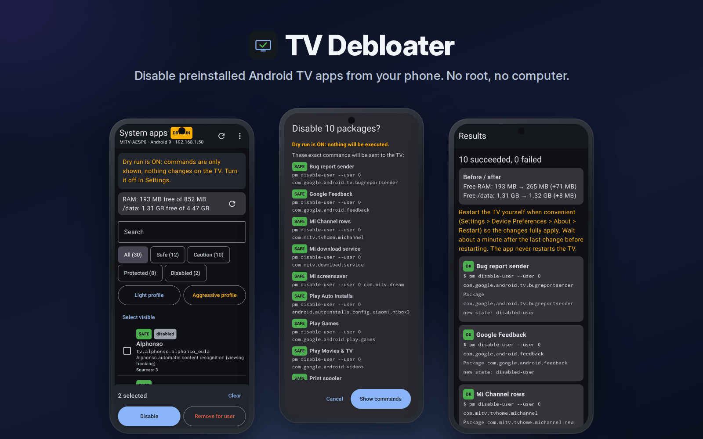
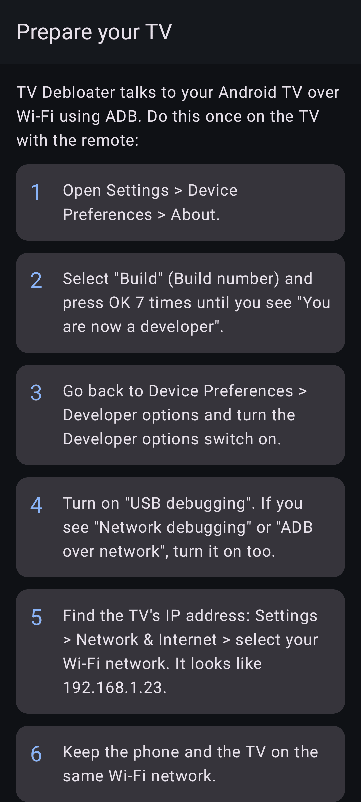
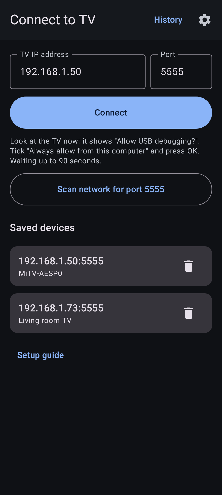
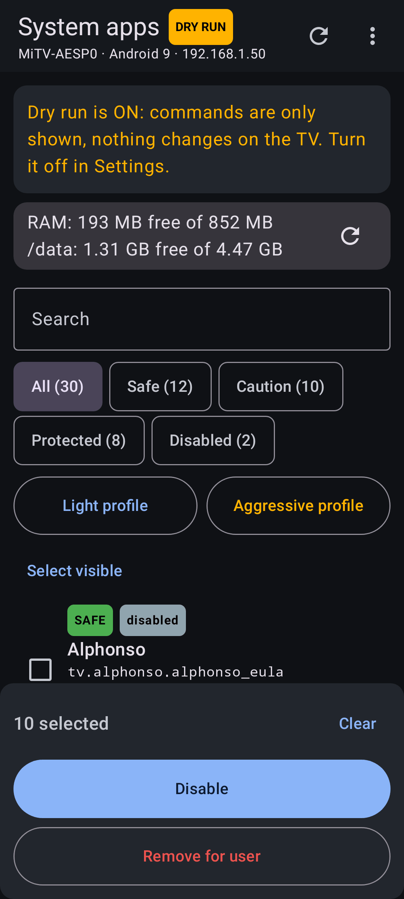
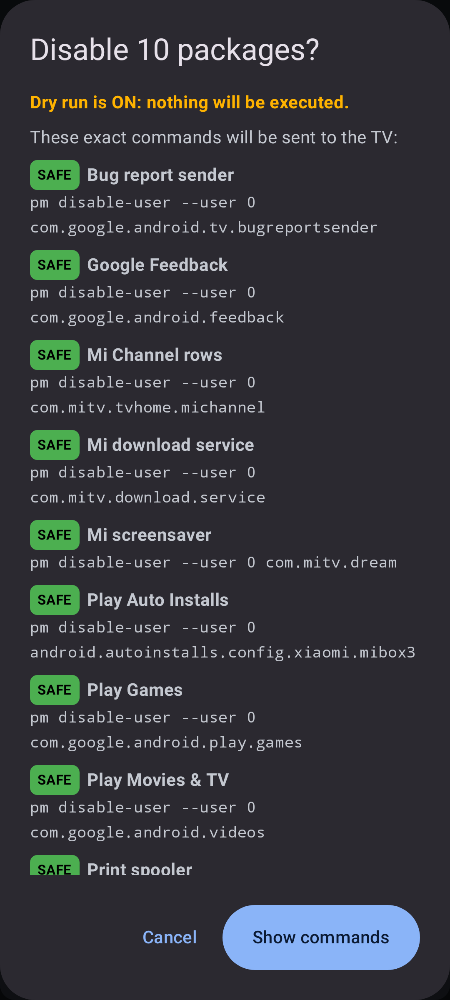
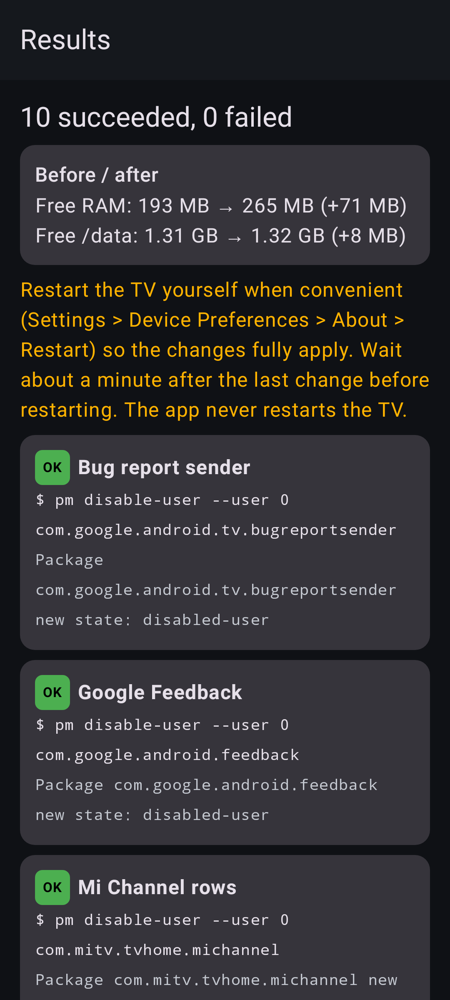
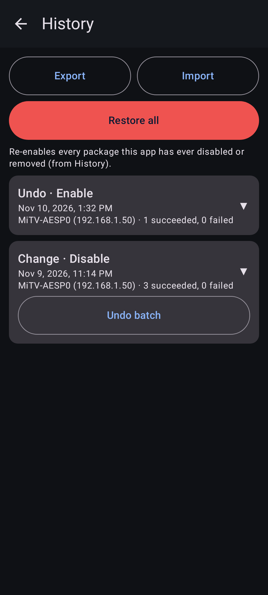
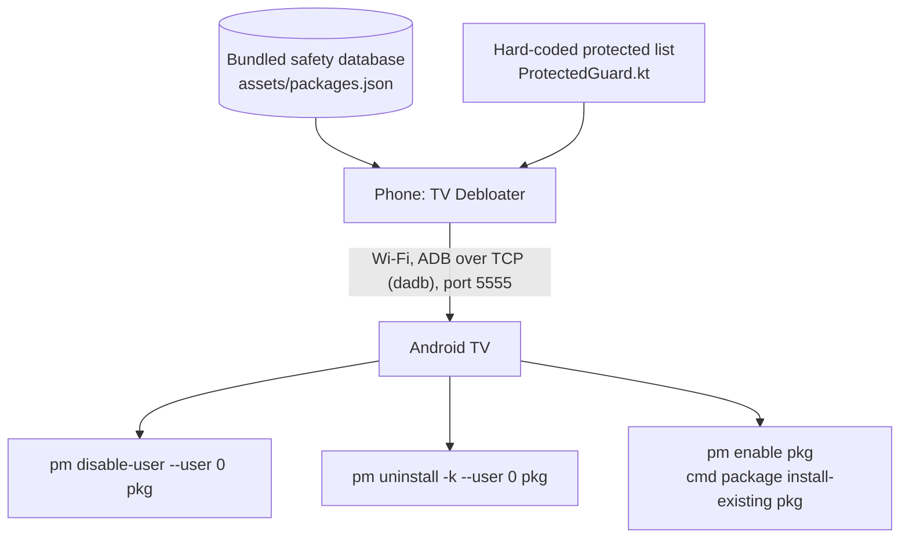

<p align="center"><b>English</b> | <a href="README.tr.md">Türkçe</a></p>

# TV Debloater

Disable preinstalled Android TV apps from your phone. No root, no computer, reversible.

<p align="center">
  <a href="https://github.com/frtymn/tv-debloater/releases/latest/download/tv-debloater-debug.apk"><b>Download</b></a> ·
  <a href="https://github.com/frtymn/tv-debloater/releases">Releases</a> ·
  <a href="#how-it-works">How it works</a> ·
  <a href="#safety">Safety</a> ·
  <a href="#troubleshooting">Troubleshooting</a> ·
  <a href="#contributing">Contributing</a>
</p>

<p align="center">
  <a href="https://github.com/frtymn/tv-debloater/stargazers"></a>
  <a href="https://github.com/frtymn/tv-debloater/releases/latest"></a>
  <a href="LICENSE"></a>
  
  <a href="https://github.com/frtymn/tv-debloater/actions/workflows/build.yml"></a>
</p>

TV Debloater is a phone app for people with a low-memory Android TV stick, such as the 1 GB Xiaomi Mi TV Stick.
It connects to the TV over Wi-Fi with ADB and lists the preinstalled system apps, each with a safety label.
You choose what to disable, and every change can be undone. You need no root and no computer.

<p align="center">
  
</p>

## Features

- **Three safety levels.** SAFE, CAUTION and PROTECTED. You cannot select protected packages.
- **Dry run.** It is on at first. The app shows the exact commands and runs nothing.
- **Backup and history.** Every batch is saved before it runs. Undo a whole batch or one package.
- **Restore all.** One button re-enables everything the app ever changed.
- **Profiles.** "Light" preselects SAFE apps. "Aggressive" adds some CAUTION apps, with a warning. You still confirm.
- **Before and after.** Free RAM and `/data` space, measured on the TV.
- **English and Turkish.** The app follows your phone's language.

## Get started

1. **Download** `tv-debloater-debug.apk` from [Releases](https://github.com/frtymn/tv-debloater/releases/latest) on your phone and open it. Allow your browser to install apps if Android asks.
2. **Prepare the TV.** Settings > Device Preferences > About: press OK on "Build" 7 times. Then turn on Developer options and "USB debugging" (and "Network debugging" if you see it).
3. **Connect.** Enter the TV's IP address (Settings > Network) and port 5555. On the TV, accept "Allow USB debugging?" and tick "Always allow".
4. **Review.** Tap "Light profile", check the list, and tap "Disable". With dry run on, you only see the commands.
5. **Apply.** Turn dry run off in Settings, run the batch again, and restart the TV yourself after about a minute.

## Screenshots

Screenshots are rendered with sample data.

<p align="center">
  
  
  
</p>
<p align="center">
  
  
  
</p>

## How it works



- The app talks to the TV with [dadb](https://github.com/mobile-dev-inc/dadb), a pure Kotlin ADB client. Its ADB key stays in the app's private storage.
- It reads the package lists with `pm list packages`, and RAM and storage with `dumpsys meminfo` and `df /data`.
- Each package gets its label from the bundled database. A package that is not in the database is shown as "Unknown" and treated as CAUTION.
- Before any command is sent, the hard-coded guard checks the package again. A protected package is refused even if the database file was edited.
- The app only changes package state for user 0. It does not root, flash, or delete user data.

The app needs classic ADB over the network on port 5555.
Android 11+ "Wireless debugging" with pairing codes is not supported yet.

## Safety

- **Reversible by default.** The default action is `pm disable-user`. The app stays on the TV and can be enabled again.
- **"Remove for user" is optional.** It runs `pm uninstall -k --user 0`. The app stays in the system image, and `cmd package install-existing` brings it back. You see a warning first.
- **Protected packages are never touched.** This covers the launcher, Play Store, Play Services, setup wizard, system UI, settings, Bluetooth and remote services, keyboards, network services, the ADB shell, and Xiaomi update and pairing services.
- **SAFE needs evidence.** A package is SAFE only if public debloat lists for the Mi TV Stick disable it. Each entry links its sources.
- **Nothing runs without you.** Dry run is on at first, and every batch shows a confirmation with every command.
- **Backup first.** The history entry is saved before the first command runs.
- **How to restore.** History > "Undo batch", or "Restore all" in the menu. Then restart the TV.
- **Last resort.** A factory reset brings back every system app. It also erases your accounts and installed apps. Use Settings > Device Preferences > Reset. If the menu does not open, unplug the stick, hold OK + Back on the remote while you plug it back in, and choose "Wipe data / factory reset" ([Xiaomi support](https://www.mi.com/uk/support/faq/details/KA-557214/)).

## Troubleshooting

- **"Connection refused".** USB debugging is off, or the TV does not accept network ADB. Turn on USB debugging (and Network debugging if present).
- **"Timed out" or "unreachable".** Check the IP address. The phone and the TV must be on the same Wi-Fi network. Try "Scan network".
- **"Not authorized".** Look at the TV: accept "Allow USB debugging?". If you declined, reconnect to see the prompt again.
- **Changes come back after a restart.** Wait about a minute after the last change, then restart the TV.
- **Something stopped working.** Undo the last batch in History, then restart the TV.
- **The TV does not start.** Factory reset it, as described in [Safety](#safety).

## Disclaimer

Use at your own risk. TV Debloater is not affiliated with or endorsed by Xiaomi, Google, or the Android project.
Android, Android TV, Google TV and Xiaomi are trademarks of their owners.
The app collects no data. It has no ads and no analytics, and it only talks to the TV address you enter on your local network.

## Build from source

You need JDK 17. The Gradle wrapper downloads everything else.

```sh
./gradlew testDebugUnitTest assembleDebug
```

The APK is in `app/build/outputs/apk/debug/`.
No computer? Fork the repository: GitHub Actions builds the APK on every push and keeps it as a downloadable artifact.

- `build.yml`: unit tests, a secret scan, and the debug APK. Tags like `v0.1.0` make a GitHub Release.
- `e2e.yml`: drives the real app against an Android TV 9 emulator.
- `docs-images.yml`: renders the screenshots, hero image and social preview. Run it from the Actions tab.

Pinned versions: Gradle 8.9, AGP 8.7.3, Kotlin 2.0.21, Compose BOM 2024.12.01, dadb 2.0.0.

## Contributing

Issues and pull requests are welcome. For big changes, open an issue first.

- Wrong safety label? Open a [package safety report](https://github.com/frtymn/tv-debloater/issues/new?template=package_safety.yml). SAFE needs a public source.
- Found a bug? Open a [bug report](https://github.com/frtymn/tv-debloater/issues/new?template=bug_report.yml) with the TV model, Android version, and the raw output.
- Security problem? Report it privately, as described in [SECURITY.md](SECURITY.md).

See [CONTRIBUTING.md](CONTRIBUTING.md) and the [Code of Conduct](CODE_OF_CONDUCT.md).

## License

Licensed under [Apache 2.0](LICENSE).
The Inter font in `docs/assets/fonts` is under the [SIL Open Font License](docs/assets/fonts/Inter-OFL-LICENSE.txt).
