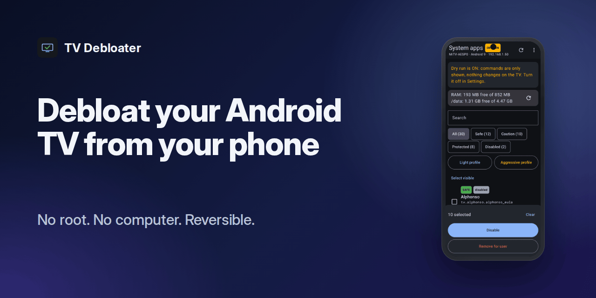
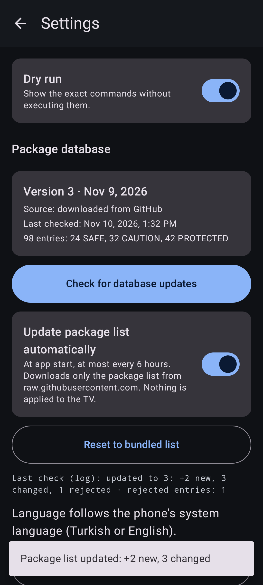
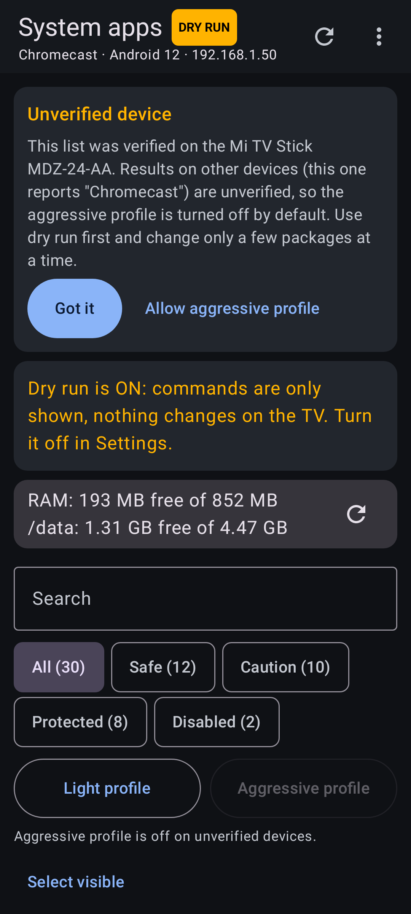
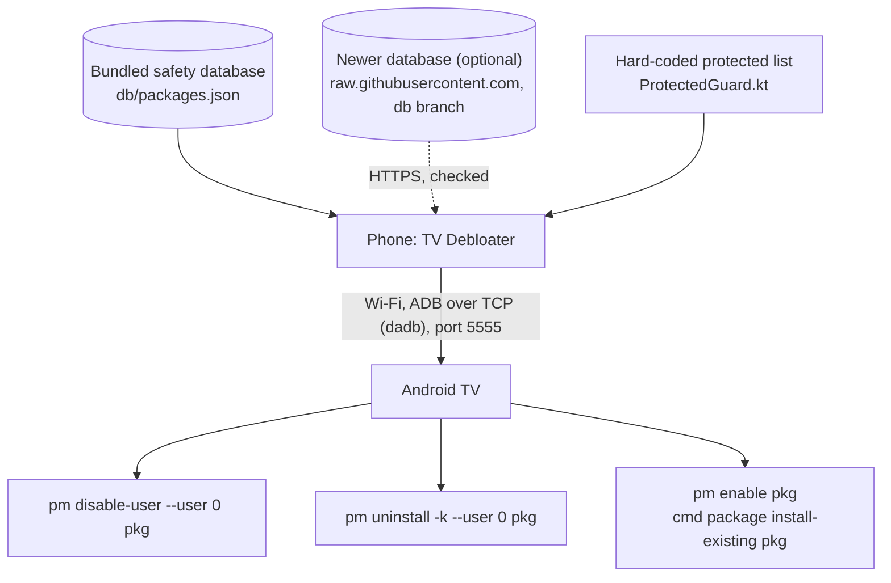

<p align="center"><b>English</b> | <a href="README.tr.md">Türkçe</a></p>

<p align="center">
  
</p>

# TV Debloater

Disable preinstalled Android TV apps from your phone. No root, no computer, reversible.

<p align="center">
  <a href="https://github.com/frtymn/tv-debloater/releases/latest/download/tv-debloater-debug.apk"><b>Download</b></a> ·
  <a href="https://github.com/frtymn/tv-debloater/releases">Releases</a> ·
  <a href="#how-it-works">How it works</a> ·
  <a href="#safety">Safety</a> ·
  <a href="#package-database">Package database</a> ·
  <a href="#troubleshooting">Troubleshooting</a> ·
  <a href="#contributing">Contributing</a>
</p>

<p align="center">
  <a href="https://github.com/frtymn/tv-debloater/stargazers"></a>
  <a href="https://github.com/frtymn/tv-debloater/releases/latest"></a>
  <a href="LICENSE"></a>
  
  <a href="https://github.com/frtymn/tv-debloater/actions/workflows/build.yml"></a>
</p>

TV Debloater is a phone app for people with a low-memory Android TV stick, such as the 1 GB Xiaomi Mi TV Stick.
It connects to the TV over Wi-Fi with ADB and lists the preinstalled system apps, each with a safety label.
You choose what to disable, and every change can be undone. You need no root and no computer.

<p align="center">
  
</p>

## Features

- **Three safety levels.** SAFE, CAUTION and PROTECTED. You cannot select protected packages.
- **Dry run.** It is on at first. The app shows the exact commands and runs nothing.
- **Backup and history.** Every batch is saved before it runs. Undo a whole batch or one package.
- **Restore all.** One button re-enables everything the app ever changed.
- **Profiles.** "Light" preselects SAFE apps. "Aggressive" adds some CAUTION apps, with a warning. You still confirm.
- **Before and after.** Free RAM and `/data` space, measured on the TV.
- **Package list updates without a new APK.** The safety database is fetched from this repository, checked strictly, and can be reset to the bundled copy. An update only changes labels, descriptions and profiles; it never changes anything on the TV.
- **Report a result.** Each package has a "Report result" button that opens a prefilled GitHub issue in your browser.
- **English and Turkish.** The app follows your phone's language.

## Get started

1. **Download** `tv-debloater-debug.apk` from [Releases](https://github.com/frtymn/tv-debloater/releases/latest) on your phone and open it. Allow your browser to install apps if Android asks.
2. **Prepare the TV.** Settings > Device Preferences > About: press OK on "Build" 7 times. Then turn on Developer options and "USB debugging" (and "Network debugging" if you see it).
3. **Connect.** Enter the TV's IP address (Settings > Network) and port 5555. On the TV, accept "Allow USB debugging?" and tick "Always allow".
4. **Review.** Tap "Light profile", check the list, and tap "Disable". With dry run on, you only see the commands.
5. **Apply.** Turn dry run off in Settings, run the batch again, and restart the TV yourself after about a minute.

### Updates

Download the new APK from [Releases](https://github.com/frtymn/tv-debloater/releases/latest) and install it over the old one. Your history and saved devices stay.
Releases from v0.1.1 on are signed with the same debug key. v0.1.0 used a different key, so Android refuses to update it: uninstall v0.1.0 first. Uninstalling deletes the app's history, so export it first (History > Export).

The package list updates on its own, without a new APK: at app start (at most every 6 hours) or when you tap Settings > Package database > "Check for database updates". Turn off "Update package list automatically" to stop the automatic checks.
If the app says "Update the app to get the newest package list", the new list needs a newer app version; the current list keeps working.

## Screenshots

Screenshots are rendered with sample data.

<p align="center">
  
  
  
</p>
<p align="center">
  
  
  
</p>
<p align="center">
  
  
</p>

## How it works



- The app talks to the TV with [dadb](https://github.com/mobile-dev-inc/dadb), a pure Kotlin ADB client. Its ADB key stays in the app's private storage.
- It reads the package lists with `pm list packages`, and RAM and storage with `dumpsys meminfo` and `df /data`.
- Each package gets its label from the active database: the newest downloaded one that passed every check, or the bundled one. A package that is not in the database is shown as "Unknown" and treated as CAUTION.
- Before any command is sent, the hard-coded guard checks the package again. A protected package is refused even if the database file was edited.
- The app only changes package state for user 0. It does not root, flash, or delete user data.

The app needs classic ADB over the network on port 5555.
Android 11+ "Wireless debugging" with pairing codes is not supported yet.

## Safety

- **Reversible by default.** The default action is `pm disable-user`. The app stays on the TV and can be enabled again.
- **"Remove for user" is optional.** It runs `pm uninstall -k --user 0`. The app stays in the system image, and `cmd package install-existing` brings it back. You see a warning first.
- **Protected packages are never touched.** This covers the launcher, Play Store, Play Services, setup wizard, system UI, settings, Bluetooth and remote services, keyboards, network services, the ADB shell, and Xiaomi update and pairing services.
- **SAFE needs evidence.** A package is SAFE only with two public sources (debloat lists for the Mi TV Stick that disable it), or one source plus a recorded test on a real device. Each entry links its sources.
- **Database updates change no TV state.** A downloaded package list can change labels and what the profiles preselect. It never runs a command, and it can never make a package from the hard-coded protected list selectable.
- **Nothing runs without you.** Dry run is on at first, and every batch shows a confirmation with every command.
- **Backup first.** The history entry is saved before the first command runs.
- **How to restore.** History > "Undo batch", or "Restore all" in the menu. Then restart the TV.
- **Last resort.** A factory reset brings back every system app. It also erases your accounts and installed apps. Use Settings > Device Preferences > Reset. If the menu does not open, unplug the stick, hold OK + Back on the remote while you plug it back in, and choose "Wipe data / factory reset" ([Xiaomi support](https://www.mi.com/uk/support/faq/details/KA-557214/)).

## Package database

The safety labels come from `db/packages.json` in this repository. The app ships a copy, and it can download newer versions without a new APK.

- **Source.** Published versions live on the [`db` branch](https://github.com/frtymn/tv-debloater/tree/db): `db/manifest.json` (version, date, size, SHA-256, counts) and `db/packages.json`. The app reads only `https://raw.githubusercontent.com/frtymn/tv-debloater/db/db/manifest.json` and the file it names. Database updates are not GitHub Releases.
- **Validation in the app.** HTTPS only, to an allowlisted host. The app checks the manifest first (with an ETag) and downloads the list only if `dbVersion` is newer. It verifies the size and SHA-256, then validates the file strictly: at most 1 MB, UTF-8, known schema, valid package names, levels SAFE/CAUTION/PROTECTED, length limits, no duplicates. A file that fails any check is rejected as a whole. An entry that conflicts with the hard-coded protected list is dropped. The app keeps the last two good versions and falls back to the bundled list. Settings > Package database > "Reset to bundled list" goes back to the bundled copy at any time.
- **Newer formats.** If a list needs a newer schema or app version, the app keeps its current list and shows "Update the app to get the newest package list".
- **Devices.** The list is verified on the Xiaomi Mi TV Stick MDZ-24-AA (`ro.product.model` = `MiTV-AESP0`). On other models the app shows a one-time notice, and the aggressive profile stays off until you allow it.
- **Reporting.** "Report result" on a package opens a prefilled [package result report](https://github.com/frtymn/tv-debloater/issues/new?template=package_result.yml) in your browser: package, level, database version, app version, device model and Android version. You fill in what you did and what happened. The app sends nothing by itself.
- **Contributing.** Edit `db/packages.json` in a pull request. CI (`db.yml`, `tools/db_build.py`) validates it against the JSON Schema and the protected list in the code, and checks the SAFE rule. A maintainer publishes it with the "Package database" workflow. See [CONTRIBUTING.md](CONTRIBUTING.md#package-database).

## Troubleshooting

- **"Connection refused".** USB debugging is off, or the TV does not accept network ADB. Turn on USB debugging (and Network debugging if present).
- **"Timed out" or "unreachable".** Check the IP address. The phone and the TV must be on the same Wi-Fi network. Try "Scan network for port 5555".
- **"Not authorized".** Look at the TV: accept "Allow USB debugging?". If you declined, reconnect to see the prompt again.
- **Changes come back after a restart.** Wait about a minute after the last change, then restart the TV.
- **Something stopped working.** Undo the last batch in History, then restart the TV.
- **The TV does not start.** Factory reset it, as described in [Safety](#safety).

## Privacy and permissions

The app collects no data. It has no ads, no analytics and no account.
On your local network it connects to the TV address you choose, and, when you tap "Scan network", to the ADB port (5555 by default) of the addresses in your phone's Wi-Fi subnet (/24).
Its only internet connection is to `raw.githubusercontent.com`, to check for a newer package list (at app start, at most every 6 hours, or when you tap the button). The request is a plain HTTPS download: no identifiers, no analytics, no device information. Turn off Settings > Package database > "Update package list automatically" to stop the automatic checks.
"Report result" only opens GitHub in your browser; the app itself sends nothing.
History, saved devices, downloaded package lists and the app's ADB key stay in the app's private storage on your phone. Export and share happen only when you tap them.

Permissions in the manifest:

- `INTERNET`: needed for any network socket: ADB over TCP to the TV, the optional scan, and the package list check on `raw.githubusercontent.com`.
- `ACCESS_NETWORK_STATE`: reads the phone's own Wi-Fi address so the scan knows which subnet to check.

v0.1.0 also declared `ACCESS_WIFI_STATE`, which it did not use. It was removed in v0.1.1.

## Disclaimer

Use at your own risk. TV Debloater is not affiliated with or endorsed by Xiaomi, Google, or the Android project.
Android, Android TV, Google TV and Xiaomi are trademarks of their owners.
The app collects no data. See [Privacy and permissions](#privacy-and-permissions).

## Build from source

You need JDK 17. The Gradle wrapper downloads everything else.

```sh
./gradlew testDebugUnitTest assembleDebug
```

The APK is in `app/build/outputs/apk/debug/`.
No computer? Fork the repository: GitHub Actions builds the APK on every push and keeps it as a downloadable artifact.

- `build.yml`: repository checks (`tools/repo_checks.py`), unit tests, a secret scan, and the debug APK. Tags like `v1.2.0` make a GitHub Release.
- `db.yml`: validates the package database on every change, and publishes it to the `db` branch when you run it by hand.
- `e2e.yml`: drives the real app against an Android TV 9 emulator.
- `docs-images.yml`: renders the screenshots, hero image and social preview. Run it from the Actions tab.

Pinned versions: Gradle 8.9, AGP 8.7.3, Kotlin 2.0.21, Compose BOM 2024.12.01, dadb 2.0.0.

## Contributing

Issues and pull requests are welcome. For big changes, open an issue first.

- Wrong safety label? Open a [package safety report](https://github.com/frtymn/tv-debloater/issues/new?template=package_safety.yml). SAFE needs a public source.
- Tried a package on your TV? Use "Report result" in the app, or open a [package result report](https://github.com/frtymn/tv-debloater/issues/new?template=package_result.yml).
- Found a bug? Open a [bug report](https://github.com/frtymn/tv-debloater/issues/new?template=bug_report.yml) with the TV model, Android version, and the raw output.
- Security problem? Report it privately, as described in [SECURITY.md](SECURITY.md).

See [CONTRIBUTING.md](CONTRIBUTING.md) and the [Code of Conduct](CODE_OF_CONDUCT.md).

## License

Licensed under [Apache 2.0](LICENSE).
The Inter font in `docs/assets/fonts` is under the [SIL Open Font License](docs/assets/fonts/Inter-OFL-LICENSE.txt).
