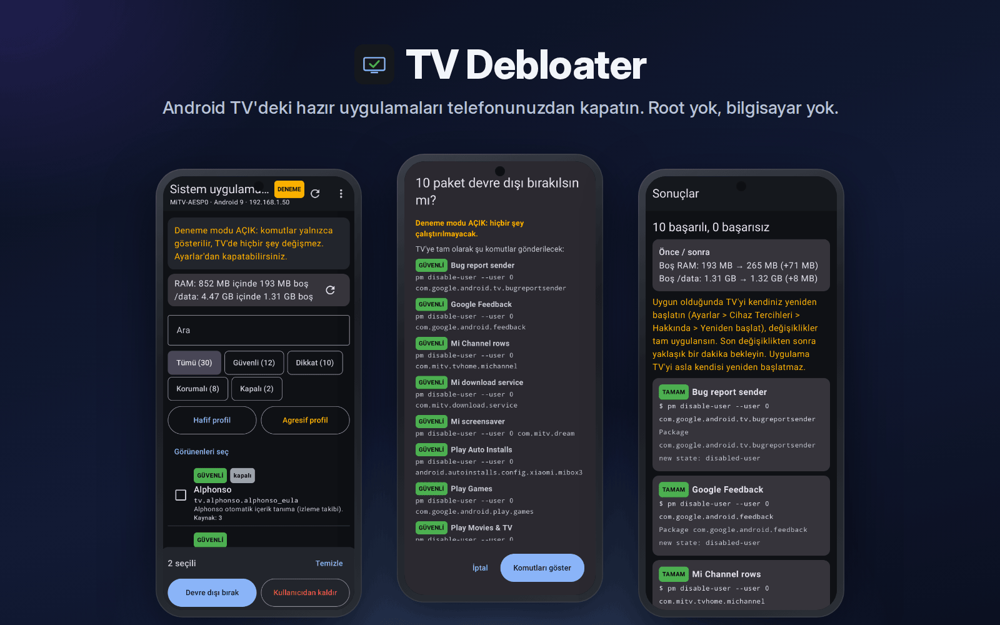
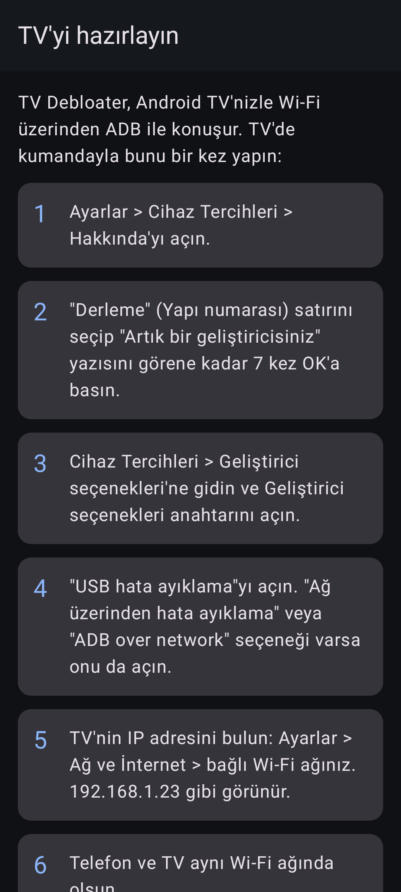
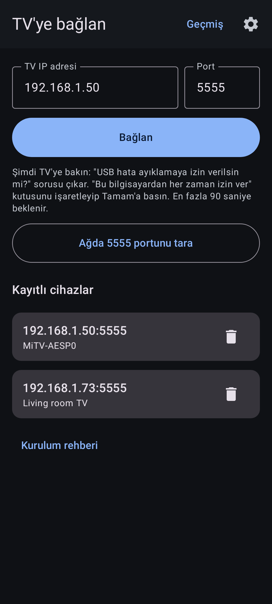
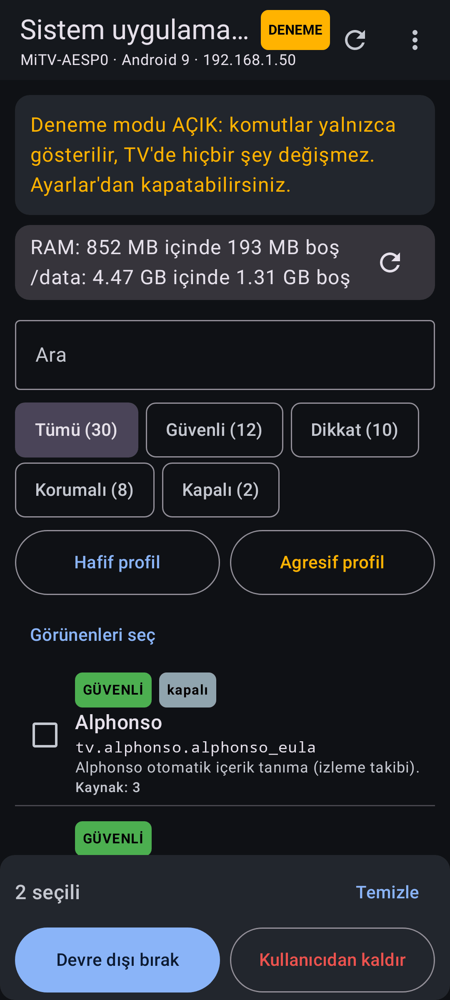
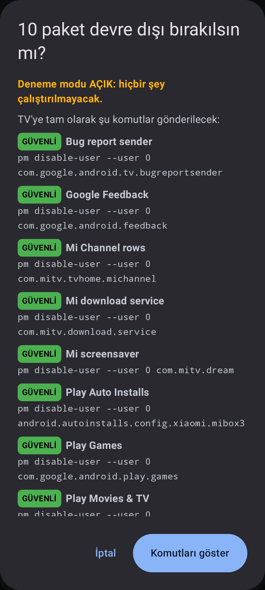
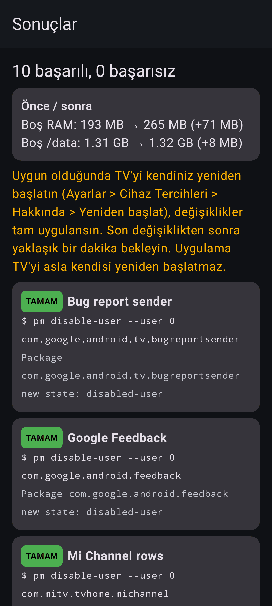
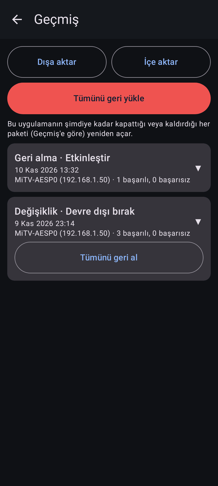
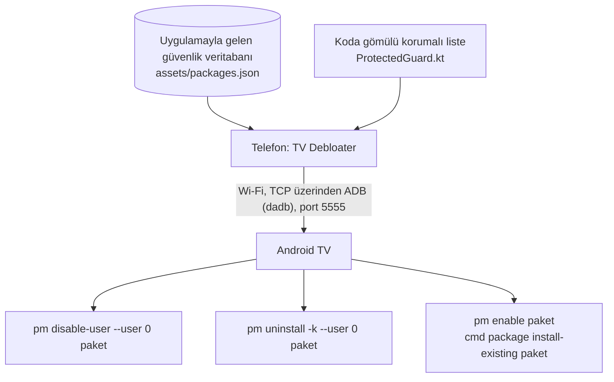

<p align="center"><a href="README.md">English</a> | <b>Türkçe</b></p>

# TV Debloater

Android TV'deki hazır uygulamaları telefonunuzdan kapatın. Root yok, bilgisayar yok, geri alınabilir.

<p align="center">
  <a href="https://github.com/frtymn/tv-debloater/releases/latest/download/tv-debloater-debug.apk"><b>İndir</b></a> ·
  <a href="https://github.com/frtymn/tv-debloater/releases">Sürümler</a> ·
  <a href="#nasıl-çalışır">Nasıl çalışır</a> ·
  <a href="#güvenlik">Güvenlik</a> ·
  <a href="#sorun-giderme">Sorun giderme</a> ·
  <a href="#katkıda-bulunma">Katkıda bulunma</a>
</p>

<p align="center">
  <a href="https://github.com/frtymn/tv-debloater/stargazers"></a>
  <a href="https://github.com/frtymn/tv-debloater/releases/latest"></a>
  <a href="LICENSE"></a>
  
  <a href="https://github.com/frtymn/tv-debloater/actions/workflows/build.yml"></a>
</p>

TV Debloater, belleği az olan Android TV çubukları için bir telefon uygulamasıdır; örneğin 1 GB RAM'li Xiaomi Mi TV Stick.
TV'ye Wi-Fi üzerinden ADB ile bağlanır ve hazır gelen sistem uygulamalarını güvenlik etiketleriyle listeler.
Neyi kapatacağınızı siz seçersiniz ve her değişiklik geri alınabilir. Root ve bilgisayar gerekmez.

<p align="center">
  
</p>

## Özellikler

- **Üç güvenlik seviyesi.** GÜVENLİ, DİKKAT ve KORUMALI. Korumalı paketler seçilemez.
- **Deneme modu.** İlk açılışta açıktır. Uygulama komutları gösterir, hiçbir şey çalıştırmaz.
- **Yedek ve geçmiş.** Her işlem grubu çalışmadan önce kaydedilir. Bir grubun tamamını veya tek paketi geri alabilirsiniz.
- **Tümünü geri yükle.** Tek düğme, uygulamanın değiştirdiği her şeyi yeniden açar.
- **Profiller.** "Hafif" GÜVENLİ uygulamaları seçer. "Agresif" bazı DİKKAT uygulamalarını da uyarıyla ekler. Onayı yine siz verirsiniz.
- **Öncesi ve sonrası.** Boş RAM ve `/data` alanı, TV üzerinde ölçülür.
- **Türkçe ve İngilizce.** Uygulama telefonunuzun dilini kullanır.

## Başlarken

1. **İndirin.** Telefonunuzda [Sürümler](https://github.com/frtymn/tv-debloater/releases/latest) sayfasından `tv-debloater-debug.apk` dosyasını indirip açın. Android sorarsa tarayıcınıza uygulama yükleme izni verin.
2. **TV'yi hazırlayın.** Ayarlar > Cihaz Tercihleri > Hakkında: "Derleme" satırına 7 kez OK basın. Sonra Geliştirici seçeneklerini ve "USB hata ayıklama"yı açın (varsa "Ağ üzerinden hata ayıklama"yı da).
3. **Bağlanın.** TV'nin IP adresini (Ayarlar > Ağ) ve 5555 portunu girin. TV'de "USB hata ayıklamaya izin verilsin mi?" sorusunu onaylayın, "Her zaman izin ver"i işaretleyin.
4. **Gözden geçirin.** "Hafif profil"e dokunun, listeyi kontrol edin ve "Devre dışı bırak"a basın. Deneme modu açıkken yalnızca komutları görürsünüz.
5. **Uygulayın.** Ayarlar'dan deneme modunu kapatın, işlemi tekrar çalıştırın ve yaklaşık bir dakika sonra TV'yi kendiniz yeniden başlatın.

## Ekran görüntüleri

Ekran görüntüleri örnek verilerle oluşturulmuştur.

<p align="center">
  
  
  
</p>
<p align="center">
  
  
  
</p>

## Nasıl çalışır



- Uygulama TV ile saf Kotlin bir ADB istemcisi olan [dadb](https://github.com/mobile-dev-inc/dadb) üzerinden konuşur. ADB anahtarı uygulamanın özel depolama alanında kalır.
- Paket listelerini `pm list packages` ile, RAM ve depolamayı `dumpsys meminfo` ve `df /data` ile okur.
- Her paketin adı uygulamayla gelen veritabanından gelir. Veritabanında olmayan paket "Bilinmiyor" olarak gösterilir ve DİKKAT sayılır.
- Her komut gönderilmeden önce koda gömülü koruma paketi yeniden kontrol eder. Veritabanı dosyası değiştirilmiş olsa bile korumalı paket reddedilir.
- Uygulama yalnızca kullanıcı 0 için paket durumunu değiştirir. Root, yazılım yükleme (flashing) veya kullanıcı verisi silme yapmaz.

Uygulama, 5555 portunda klasik ağ üzerinden ADB ister.
Android 11+ ile gelen eşleştirme kodlu "Kablosuz hata ayıklama" henüz desteklenmiyor.

## Güvenlik

- **Varsayılan olarak geri alınabilir.** Varsayılan işlem `pm disable-user`'dır. Uygulama TV'de kalır ve yeniden açılabilir.
- **"Kullanıcıdan kaldır" isteğe bağlıdır.** `pm uninstall -k --user 0` çalıştırır. Uygulama sistem imajında kalır, `cmd package install-existing` onu geri getirir. Önce bir uyarı görürsünüz.
- **Korumalı paketlere asla dokunulmaz.** Başlatıcı, Play Store, Play Hizmetleri, kurulum sihirbazı, sistem arayüzü, ayarlar, Bluetooth ve kumanda servisleri, klavyeler, ağ servisleri, ADB kabuğu ve Xiaomi güncelleme ve eşleştirme servisleri bunlara dahildir.
- **GÜVENLİ için kanıt gerekir.** Bir paket, yalnızca Mi TV Stick için yayınlanmış debloat listeleri onu kapatıyorsa GÜVENLİ sayılır. Her girdi kaynaklarını gösterir.
- **Siz onaylamadan hiçbir şey çalışmaz.** Deneme modu ilk açılışta açıktır ve her işlem grubu, komutların tamamını listeleyen bir onay penceresi gösterir.
- **Önce yedek.** Geçmiş kaydı ilk komut çalışmadan önce kaydedilir.
- **Nasıl geri alınır.** Geçmiş > "Tümünü geri al" ya da menüdeki "Tümünü geri yükle". Sonra TV'yi yeniden başlatın.
- **Son çare.** Fabrika ayarlarına sıfırlama tüm sistem uygulamalarını geri getirir. Hesaplarınızı ve kurduğunuz uygulamaları da siler. Ayarlar > Cihaz Tercihleri > Sıfırla'yı kullanın. Menü açılmıyorsa çubuğun gücünü çekin, kumandada OK + Geri tuşlarını basılı tutarak gücü yeniden takın ve "Wipe data / factory reset"i seçin ([Xiaomi destek](https://www.mi.com/uk/support/faq/details/KA-557214/)).

## Sorun giderme

- **"Bağlantı reddedildi".** USB hata ayıklama kapalı ya da TV ağ üzerinden ADB kabul etmiyor. USB hata ayıklamayı (varsa Ağ üzerinden hata ayıklamayı da) açın.
- **"Zaman aşımı" veya "ulaşılamıyor".** IP adresini kontrol edin. Telefon ve TV aynı Wi-Fi ağında olmalı. "Ağda tara"yı deneyin.
- **"Yetkisiz".** TV'ye bakın ve "USB hata ayıklamaya izin verilsin mi?" sorusunu onaylayın. Reddettiyseniz soruyu tekrar görmek için yeniden bağlanın.
- **Değişiklikler yeniden başlatınca geri geliyor.** Son değişiklikten sonra yaklaşık bir dakika bekleyin, sonra TV'yi yeniden başlatın.
- **Bir şey çalışmayı bıraktı.** Geçmiş'ten son işlem grubunu geri alın, sonra TV'yi yeniden başlatın.
- **TV açılmıyor.** [Güvenlik](#güvenlik) bölümünde anlatıldığı gibi fabrika ayarlarına sıfırlayın.

## Sorumluluk reddi

Kullanım riski size aittir. TV Debloater; Xiaomi, Google veya Android projesiyle bağlantılı değildir ve onlar tarafından onaylanmamıştır.
Android, Android TV, Google TV ve Xiaomi, sahiplerinin ticari markalarıdır.
Uygulama hiçbir veri toplamaz. Reklam ve analitik içermez, yalnızca yerel ağınızda girdiğiniz TV adresiyle konuşur.

## Kaynaktan derleme

JDK 17 gerekir. Gradle wrapper geri kalan her şeyi indirir.

```sh
./gradlew testDebugUnitTest assembleDebug
```

APK `app/build/outputs/apk/debug/` klasörüne çıkar.
Bilgisayarınız yok mu? Depoyu fork'layın: GitHub Actions her push'ta APK'yı derler ve indirilebilir bir artifact olarak saklar.

- `build.yml`: birim testleri, gizli bilgi taraması ve debug APK. `v0.1.0` gibi etiketler bir GitHub Release oluşturur.
- `e2e.yml`: gerçek uygulamayı bir Android TV 9 emülatörüne karşı çalıştırır.
- `docs-images.yml`: ekran görüntülerini, kapak görselini ve sosyal önizlemeyi üretir. Actions sekmesinden çalıştırın.

Sabitlenmiş sürümler: Gradle 8.9, AGP 8.7.3, Kotlin 2.0.21, Compose BOM 2024.12.01, dadb 2.0.0.

## Katkıda bulunma

Issue ve pull request'ler memnuniyetle karşılanır. Büyük değişiklikler için önce bir issue açın.

- Yanlış güvenlik etiketi mi? Bir [paket güvenlik bildirimi](https://github.com/frtymn/tv-debloater/issues/new?template=package_safety.yml) açın. GÜVENLİ için herkese açık bir kaynak gerekir.
- Hata mı buldunuz? TV modeli, Android sürümü ve ham çıktıyla bir [hata bildirimi](https://github.com/frtymn/tv-debloater/issues/new?template=bug_report.yml) açın.
- Güvenlik sorunu mu? [SECURITY.md](SECURITY.md) dosyasında anlatıldığı gibi gizli olarak bildirin.

Ayrıntılar için [CONTRIBUTING.md](CONTRIBUTING.md) ve [Davranış Kuralları](CODE_OF_CONDUCT.md) dosyalarına bakın.

## Lisans

[Apache 2.0](LICENSE) lisansı ile yayınlanmıştır.
`docs/assets/fonts` içindeki Inter yazı tipi [SIL Open Font License](docs/assets/fonts/Inter-OFL-LICENSE.txt) altındadır.
